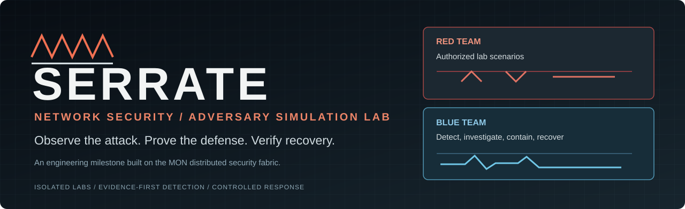
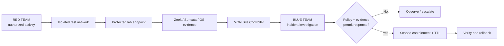
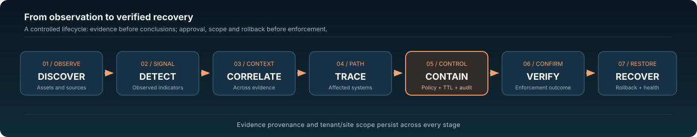
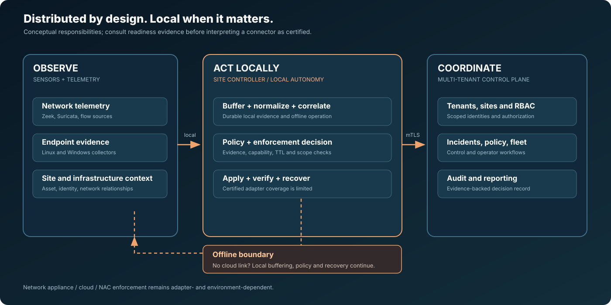
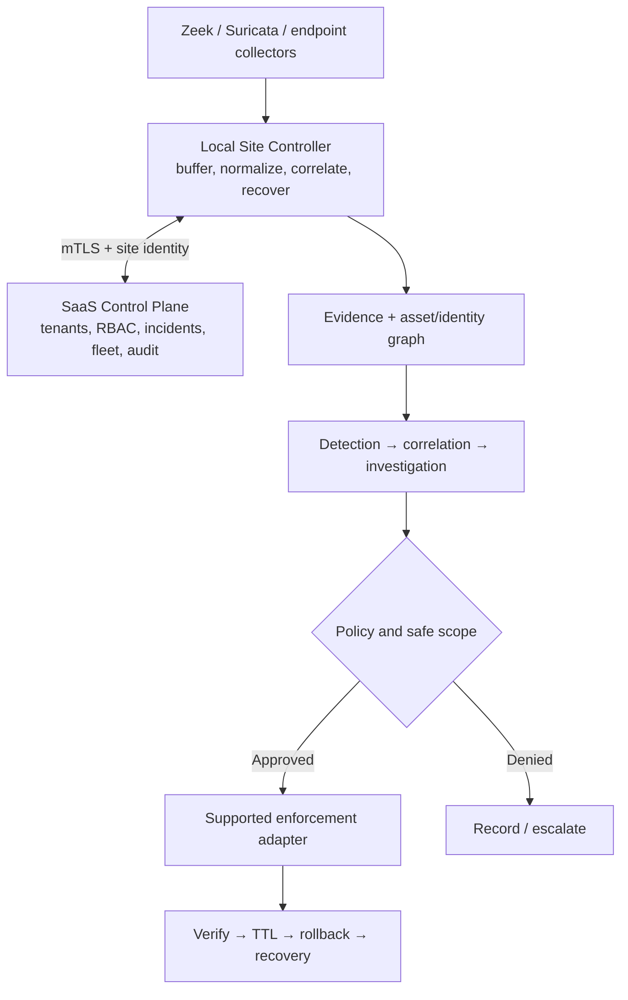
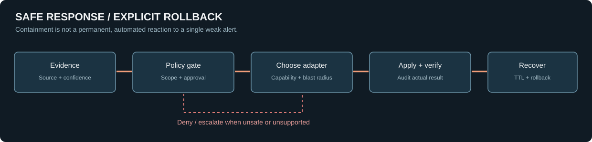

<p align="center"></p>

<p align="center">
  <a href="#the-project">Project</a> ·
  <a href="#red-team--blue-team-sandbox">Sandbox</a> ·
  <a href="#system-flow">Architecture</a> ·
  <a href="#defend-and-recover">Response workflow</a> ·
  <a href="docs/WORKFLOWS.md">Flowcharts</a> ·
  <a href="docs/LICENSING.md">License & ownership</a>
</p>

<p align="center">
  <a href="https://github.com/Saitanveesh/1/actions/workflows/ci.yml"></a>
  <a href="https://github.com/Saitanveesh/1/actions/workflows/final-readiness.yml"></a>
  
  
</p>

**SERRATE** is my engineering milestone in distributed network-security detection and response, demonstrated through controlled **red-team and blue-team lab exercises**. A test client generates *authorized* activity in an isolated network; MON's sensors and Site Controller observe evidence; the blue team investigates, traces affected systems and evaluates bounded containment; recovery is explicitly verified.

The platform's original internal name remains **MON Security Fabric**. Its Python modules, `MON_*` configuration, services and historical deployment references are **not being renamed or broken** for a presentation change.

> [!IMPORTANT]
> **Not a production-certified offensive security suite or an unrestricted exploit framework.** Existing lab simulations, acceptance tests and operational modules have different degrees of validation. The current `main` branch is an audited foundation; advanced lab integration exists on separate, unmerged branches. Illustrations are explanatory, not proof of live sensors or confirmed compromises. See [lab scope](docs/SANDBOX.md), [readiness evidence](docs/production-readiness.md) and [release reconciliation](docs/repository-maintenance/README.md).

## The project

Rather than asking only *“Did the IDS raise an alert?”*, SERRATE aims to answer:

| Investigation question | System responsibility |
|---|---|
| What is happening? | Network, endpoint and flow telemetry |
| Which host, user or service? | Asset and identity graph |
| Is the activity internal, external or lateral? | Network/topology context and correlated evidence |
| Where did the activity originate and travel? | Investigation and attack-path graph |
| Can it be contained without damaging critical services? | Enforcement graph, policy decision and approvals |
| Did the containment work? | Explicit verification and audit |
| Can we restore normal operation? | TTL, rollback and recovery health checks |

No single perimeter firewall is assumed to be sufficient. A high-volume DDoS attack saturating an upstream link cannot be fixed by a host firewall downstream.

## Red-team / blue-team sandbox



The test source and monitoring system are **separate roles**. Synthetic presentation scenarios are marked as synthetic; real findings require actual sensor evidence. Attack emulation is permitted **only on authorized, segmented lab systems**. See [sandbox methodology and evidence limits](docs/SANDBOX.md).

<p align="center"></p>

## System flow

<p align="center"></p>



**Site autonomy matters:** losing the SaaS link must not erase buffered events or prevent already-authorized local recovery. Network enforcement requires a real adapter and a compatible test environment—not an icon on a diagram.

[Architecture baseline](docs/ARCHITECTURE.md) · [Technical flowcharts](docs/WORKFLOWS.md) · [Site Controller](docs/site-controller.md)

## Defend and recover

<p align="center"></p>

A proposed action must identify **incident, target, evidence, confidence, policy decision, enforcement point, TTL, blast radius, actor, timestamps, audit record, verification result and rollback**. Critical assets must not be permanently isolated automatically from a single weak signal.

## What is evidenced today

| Evidence tier | Scope |
|---|---|
| **Implemented foundation on `main`** | Typed tenant/site APIs; PostgreSQL/RLS; site identity and mTLS; sensor normalization; Site Controller; event fabric; event/identity analysis; correlation and investigation; response and recovery orchestration; React SOC console |
| **Verified in CI/disposable environments** | Unit/integration and API checks; Windows service lifecycle on CI runners; Linux nftables in disposable namespaces; restart/mTLS, tenant isolation and rollback regression cases |
| **Lab history and open implementation work** | Seven-system and three-host topologies, live operator-console branches, sensor enrollment, traffic and containment demonstrations. Verify the **deployed SHA and actual observations** before claiming any specific scenario as active |
| **Not certified production-wide** | All firewall/NAC/cloud connectors, all endpoint distributions, universal upstream DDoS protection, enterprise-scale HA or completed general-purpose red-team automation |

A synthetic narrated walkthrough is provided at [`demo/mon_cinematic/`](demo/mon_cinematic/); it does **not** create a real incident. [Production-readiness ledger](docs/production-readiness.md) is the evidence boundary.

## Milestone architecture and engineering

- **Languages:** Python security engines/control plane, TypeScript/React SOC UI, OS-native Windows/Linux collector boundaries.
- **Security design:** tenant/site scoping, evidence provenance, RBAC, encrypted connector-secret handling, mTLS, policy-gated containment and audit.
- **Resilience:** durable local state, offline site autonomy, replay/idempotency, recovery, verification and testable rollback.
- **Operations:** PostgreSQL migrations, acceptance CI, multi-OS collector testing, packaging and release gates.
- **Development discipline:** ADRs, integration tests and a managed branch/release reconciliation process.

[Detailed implementation snapshot](docs/implementation-status-main-2026-10-08.md) · [Project charter](PROJECT_INSTRUCTIONS.md) · [Milestone boundaries](docs/SANDBOX.md)

## Run and inspect the source

**Development environment only.** Requires Python 3.12+, and Node.js 22 for the operator console.

```bash
git clone https://github.com/Saitanveesh/1.git
cd 1
python -m venv .venv
source .venv/bin/activate
pip install -e '.[dev]'
ruff check .
pytest -q
```

Console:

```bash
cd console
npm install --no-audit --no-fund
npm test
npm run build
```

The checked-in Compose file contains **development credentials** and publishes a port. Do not expose it as a production service or run attacks against a shared campus/private LAN. Set up proper authorization, segmentation, secrets and recovery first.

## Source structure

| Path | Purpose |
|---|---|
| [`src/mon/`](src/mon/) | Security-engine and Site Controller implementation; stable internal MON naming |
| [`console/`](console/) | SOC command console |
| [`migrations/`](migrations/) | Database state changes; retain in order |
| [`tests/`](tests/) + [`e2e/`](e2e/) | Regression and browser acceptance |
| [`docs/WORKFLOWS.md`](docs/WORKFLOWS.md) | Readable, source-controlled flowcharts |
| [`docs/SANDBOX.md`](docs/SANDBOX.md) | Red/blue lab design and scope |
| [`docs/repository-maintenance/`](docs/repository-maintenance/) | Branch traceability and safe retirement |
| [`docs/adr/`](docs/adr/) | Accepted architecture decisions |
| [`docs/LICENSING.md`](docs/LICENSING.md) | Author rights, source visibility and license selection |

## Authorship and licensing

**SERRATE/MON is a personal engineering repository maintained by Sai Tanveesh.** Original contributions remain under their legitimate copyright owners; upstream dependencies remain under their respective terms.

**No root open-source license has been issued.** It is currently publicly visible source, **not permission for commercial redistribution or reuse**. See [the detailed licensing and copyright policy](docs/LICENSING.md) before copying or contributing substantial code. Read [SECURITY.md](SECURITY.md) for disclosure and [CONTRIBUTING.md](CONTRIBUTING.md) for test requirements.

<p align="center"><sub>SERRATE • Network Security & Adversary Simulation Lab • Built on MON • Observe. Contain. Recover.</sub></p>
