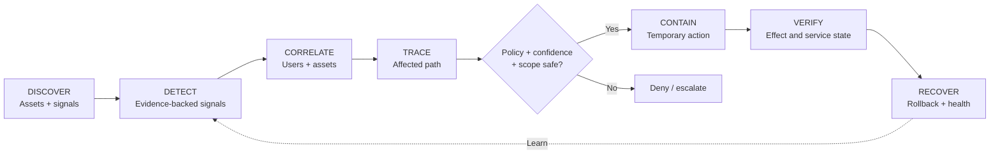
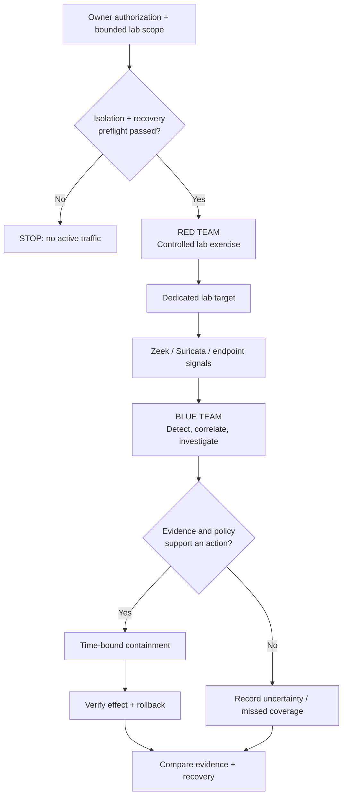
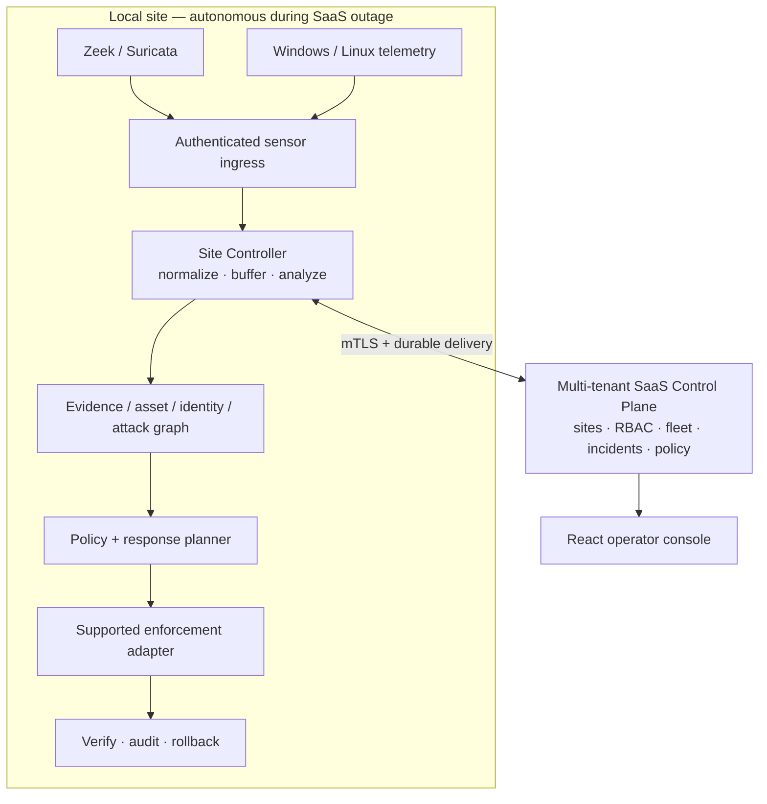
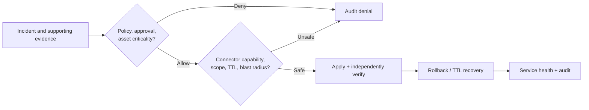

# GAUNT

**Security Fabric · Red/Blue Cyber Range · Incident Response**

*Attack in the lab. Defend with evidence. Verify recovery.*

GAUNT is the public name for the **MON Security Fabric** engineering milestone. It connects network and endpoint observations to evidence-backed detection, investigation, safe containment, and recovery—and documents **authorized red-team / blue-team exercises** performed in a controlled lab track.

Unlike a generic alert dashboard, the engineering objective is to explain **what happened, which asset or identity was involved, how activity traveled, where it can be contained, whether enforcement worked, and whether service recovered.**

> **Status:** Engineering/research milestone, not a commercially certified defense product or turnkey Kali-like attack framework. `main` is the stable implementation foundation; later three-PC lab work lives on separate, unmerged branches. No automatic isolation of a shared network is guaranteed. [Readiness evidence](docs/production-readiness.md) · [Lab safety and evidence](docs/RED_BLUE_RANGE.md).

[Red/blue lab](#authorized-red--blue-exercises) · [Architecture](#distributed-architecture) · [Milestones](docs/MILESTONES.md) · [Workflows](docs/WORKFLOWS.md) · [Licensing](docs/LICENSING.md) · [Branches](docs/BRANCH_POLICY.md)

## The seven-stage response lifecycle



Every response must identify the incident, target, evidence, confidence, actor, enforcement point, policy decision, TTL, estimated blast radius, timestamps, actual result, audit record and rollback. Critical infrastructure cannot be permanently isolated on one weak signal.

## Authorized red / blue exercises



This is a **red/blue validation workflow**, not a claim that an attack generator or a hardware sandbox ships ready to run. The [historical advanced lab branch](https://github.com/Saitanveesh/1/tree/release/mon-batch4-rc1) contains additional PC5 training-target code, tests and operator work **not integrated into `main`**. The `main` [narrated demo](demo/mon_cinematic/README.md) is **synthetic storytelling**, not real attack traffic or proof of incident response. Never conduct exercises on a shared campus LAN without verified segmentation. [Range guidance](docs/RED_BLUE_RANGE.md).

## Distributed architecture



MON separates **detection from enforcement**. An intervention may require an endpoint firewall, switch/NAC, router, cloud control or upstream provider, but only certified available adapters can execute it. A local firewall cannot rescue an uplink saturated upstream by volumetric DDoS.

## Reversible containment



## Engineering milestones and proof

| Scope | Recorded state |
|---|---|
| **Foundation on `main`** | Typed tenant/site APIs, PostgreSQL/RLS, site autonomy, Zeek/Suricata normalization, Windows/Linux collector adapters, evidence and graph foundations, response TTL/audit and React console |
| **Controlled verification** | Python/integration, browser, PostgreSQL, mTLS restart, disposable Linux enforcement and Windows service CI |
| **Advanced lab branch** | Additional multi-host operator and training-target features; must be reconciled with `main` before claiming a unified build |
| **Unproven production breadth** | Universal hardware isolation, complete EDR, arbitrary NAC/router/cloud integrations, customer deployment certification or upstream DDoS mitigation |

The [milestone dossier](docs/MILESTONES.md) separates **implemented**, **CI-validated**, **lab-observed**, **synthetic**, and **proposed** work. Do not invent attack success rates or sensor status.

## Development

Python 3.12+:

```bash
git clone https://github.com/Saitanveesh/1.git
cd 1
python -m venv .venv
source .venv/bin/activate
python -m pip install -e '.[dev]'
ruff check .
pytest -q
```

React console (Node.js 22):

```bash
cd console
npm install --no-audit --no-fund
npm test
npm run build
```

The example `compose.yaml` contains development credentials and a published port. **Do not expose it as a production or shared-network sandbox.** Test native enforcement first in disposable namespaces, VMs or CI. [Site Controller guide](docs/site-controller.md) · [Security policy](SECURITY.md).

## Repository layout

| Path | Purpose |
|---|---|
| [`src/mon/`](src/mon/) | Existing MON security fabric Python services |
| [`console/`](console/) | React/TypeScript operator UI |
| [`tests/`](tests/) and [`e2e/`](e2e/) | Security, regression and acceptance tests |
| [`migrations/`](migrations/) | PostgreSQL schema history (preserve) |
| [`docs/adr/`](docs/adr/) | Architecture decisions (preserve) |
| [`docs/WORKFLOWS.md`](docs/WORKFLOWS.md) | Technical flow diagrams |
| [`docs/RED_BLUE_RANGE.md`](docs/RED_BLUE_RANGE.md) | Authorized exercise boundaries |
| [`docs/BRANCH_POLICY.md`](docs/BRANCH_POLICY.md) | Branch cleanup and deployment reconciliation |

## Ownership and licensing

**Maintainer and original project contributor: Sai Tanveesh.** Third-party frameworks, engines and other contributors retain their rights; repo ownership is not proof of sole authorship of every component. Original owner-authored code and documentation are currently **source available, all rights reserved**—not MIT/Apache/GPL open source. See [LICENSE](LICENSE), [licensing and ownership details](docs/LICENSING.md) and [third-party notices](THIRD_PARTY_NOTICES.md).

**Compatibility:** GAUNT is the *public project identity*. Internally, `MON_*`, the `mon` Python package, APIs, databases, service commands and repository URL remain unchanged to avoid breaking deployed lab components. [Naming policy](docs/BRAND.md) · [Contribution guide](CONTRIBUTING.md).
