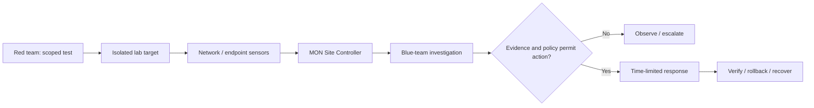

# SERRATE

**Network Security & Adversary Simulation Lab**

SERRATE is a network-security research and engineering project for controlled red-team/blue-team exercises. It brings together network and endpoint telemetry, incident investigation, policy-controlled response, and recovery verification.

The implementation retains its original internal name, **MON Security Fabric**. Python modules, `MON_*` settings, service names, and database/API identifiers have not been renamed.

**Project status:** Engineering and lab-development software, **not a production-certified security product**. Capabilities vary by branch and environment; diagrams and synthetic scenarios are not evidence of live attacks or deployed sensors.

## What it does

| Area | Implementation focus |
| --- | --- |
| Detection and telemetry | Zeek/Suricata ingestion, endpoint observations, normalized security events |
| Investigation | Event correlation, asset and identity relationships, attack-path evidence |
| Site operation | Local buffering, identity-aware sensor ingress, and recovery during upstream connectivity loss |
| Response | Policy checks, scoped enforcement adapters, verification, time limits, and rollback |
| Operator interface | React-based SOC console for incidents, telemetry, assets, enforcement, audit, and sensor health |
| Validation | Python tests, console tests, CI gates, and disposable-environment adapter checks |

These are areas represented in the source tree, not a claim that every connector, attack scenario, or production deployment is complete. See [the readiness record](docs/production-readiness.md) for specific evidence and limitations.

## Lab workflow

SERRATE separates the systems generating **authorized test activity** from the systems collecting and analyzing evidence.



An exercise should have written authorization, network isolation, a stop condition, and a tested recovery plan. **Do not run traffic floods or enforcement tests on a shared LAN or a production system.** The [sandbox guide](docs/SANDBOX.md) explains the scope and evidence requirements.

## Architecture

The source separates a local Site Controller from the multi-tenant control plane:

- **Sensors and collectors:** gather network and endpoint observations.
- **Site Controller:** buffers and processes site-scoped events, with local recovery behavior.
- **Control plane:** maintains tenants, users, sites, incidents, policies, and audit records.
- **Investigation and response:** correlates evidence before selecting an applicable enforcement adapter; verification and rollback are explicit steps.
- **SOC console:** presents available operational data through a TypeScript/React interface.

[Architecture reference](docs/ARCHITECTURE.md) · [Technical workflows](docs/WORKFLOWS.md) · [Lab boundaries](docs/SANDBOX.md) · [Architecture decisions](docs/adr/)

## Repository layout

| Path | Contents |
| --- | --- |
| [`src/mon/`](src/mon/) | Security engines, API, collectors, and Site Controller |
| [`console/`](console/) | SOC operator interface |
| [`tests/`](tests/) and [`e2e/`](e2e/) | Unit, integration, and end-to-end checks |
| [`migrations/`](migrations/) | Database migrations |
| [`docs/`](docs/) | Architecture, lab methodology, verification records, and ADRs |
| [`demo/mon_cinematic/`](demo/mon_cinematic/) | **Synthetic** walkthrough; not live sensor evidence |

The [repository maintenance notes](docs/repository-maintenance/README.md) distinguish the audited `main` baseline from unmerged experimental work. Do not infer feature availability from branch names.

## Development checks

Requirements: Python 3.12+; Node.js 22 for the console.

```bash
git clone https://github.com/Saitanveesh/SERRATE.git
cd SERRATE
python -m venv .venv
# Activate .venv using your operating system's shell
python -m pip install -e '.[dev]'
python -m ruff check .
python -m pytest -q
```

To check the console:

```bash
cd console
npm install --no-audit --no-fund
npm test
npm run build
```

These commands perform development checks; they are **not** a one-command deployment of a functioning red/blue range. The checked-in `compose.yaml` uses development credentials and published ports. Review it before use and never expose it on an untrusted network.

## Maintainer

**Sai Tanveesh** — developer and project maintainer

[GitHub: @Saitanveesh](https://github.com/Saitanveesh) · [LinkedIn: Sai Tanveesh](https://www.linkedin.com/in/sai-tanveesh-028881215/)

Issues and responsible disclosure: [Security policy](SECURITY.md) · [Contribution guidance](CONTRIBUTING.md)

## Copyright and permissions

Copyright © 2026 Sai Tanveesh for original material authored and owned by him. **All rights reserved.**

SERRATE is **publicly viewable, not open-source licensed**. The root [LICENSE](LICENSE) records that no general permission to copy, modify, redistribute, sublicense, or commercially use the proprietary material is granted. Applicable law, GitHub's platform terms, third-party licenses, and any previously granted rights still apply. For permission requests and provenance details, see [licensing policy](docs/LICENSING.md).

Third-party components and their trademarks remain subject to their own terms.
