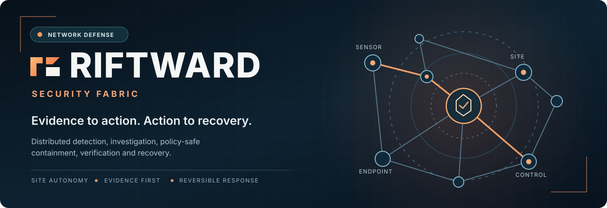

<p align="center">
  
</p>

<p align="center">
  <a href="#why-riftward">Why RIFTWARD</a> ·
  <a href="#how-it-works">Workflow</a> ·
  <a href="#system-architecture">Architecture</a> ·
  <a href="#development">Development</a> ·
  <a href="docs/WORKFLOWS.md">Technical flows</a> ·
  <a href="docs/BRAND.md">Brand guide</a>
</p>

<p align="center">
  <a href="https://github.com/Saitanveesh/1/actions/workflows/ci.yml"></a>
  <a href="https://github.com/Saitanveesh/1/actions/workflows/final-readiness.yml"></a>
  
  
  
</p>

<p align="center"><strong>Distributed network defense with verifiable evidence, deliberate enforcement and reversible recovery.</strong></p>

**RIFTWARD** is a critical-network security fabric that connects network and endpoint observations to investigations, affected-asset context, policy decisions and recovery workflows. **MON** remains the existing implementation name (`mon` package, `MON_*` configuration, scripts and services); the public brand is being introduced without breaking deployed components.

> [!IMPORTANT]
> **Development foundation, not a production-certified release.** The audited `main` integration baseline does not include all later laboratory branches. Some Linux enforcement adapters are certified only in disposable namespaces; cloud/NAC/router/WAF integrations are target capabilities, not all implemented. Do not infer live telemetry, deployed sensor health or incident results from these diagrams or the synthetic demo. See [readiness evidence](docs/production-readiness.md) and [branch reconciliation](docs/repository-maintenance/README.md).

## Why RIFTWARD

Security incidents rarely respect the border of one firewall. A host, identity and service may span endpoint, switch, router, cloud and multiple sites. RIFTWARD is designed to answer **what happened, what evidence proves it, who is affected, where intervention is safest, and whether the network actually recovered**.

The differentiator is not another alert counter: it is the **evidence → context → path → safe action → verified recovery** workflow.

## How it works

<p align="center">
  
</p>

The lifecycle is:

```text
DISCOVER → DETECT → CORRELATE → TRACE → CONTAIN → VERIFY → RECOVER
```

**Evidence first.** Preserve source, timestamp, tenant/site boundary and confidence. **Control second.** Select the safest available, certified enforcement capability with approval, scope, blast-radius estimation and TTL. **Recovery is part of the response.** Verify enforcement, audit the outcome, roll back and check service health.

For decision paths and failure-mode handling, see the [illustrated workflow guide](docs/WORKFLOWS.md).

## System architecture

<p align="center">
  
</p>

| Boundary | Responsibility |
|---|---|
| **Network and endpoint sources** | Zeek/Suricata metadata, Linux/Windows collector evidence, network identity context |
| **Local Site Controller** | Normalization, durable buffering, correlation, local policy execution and recovery |
| **SaaS Control Plane** | Tenant/site identity, RBAC, fleet, incidents, policies, audit and operator coordination |
| **Evidence and graph layer** | Correlation, asset/identity relationships, investigation paths, enforcement capabilities |
| **Response execution** | Policy/approval checks, TTL, scoped action, verification, reconciliation and rollback |
| **Operator console** | React/TypeScript SOC views backed by real APIs rather than placeholder health metrics |

```text
Sensors + endpoint evidence
              |
              v
    Local Site Controller  <==== mTLS ====>  SaaS Control Plane
              |                                |
      Evidence + correlation              RBAC / incidents / policy
              |
      Policy + approval + TTL
              |
   Verified enforcement adapter
              |
      Audit + rollback + recovery
```

**Important:** Site-local operation remains a design requirement when SaaS is unreachable. A target diagram does not mean every vendor connector or native endpoint agent is certified on production infrastructure. [Architecture baseline](docs/ARCHITECTURE.md).

## Containment without guessing

<p align="center">
  
</p>

A response needs a target, supporting evidence, confidence, policy outcome, selected enforcement point, expected blast radius, actor, TTL, audit record, actual result and rollback. Weak or contradictory signals must **not** justify permanent isolation of critical assets. A local firewall also cannot solve volumetric saturation that happens upstream of the link.

## What's implemented — and what is not

| Status | Examples |
|---|---|
| **Implemented foundations on audited `main`** | Typed tenant/site APIs and domain data; PostgreSQL migrations/RLS; sensor ingest; Site Controller; local event fabric; Windows/Linux collector adapters; evidence/correlation graph foundations; response/TTL state; audit; React operator console |
| **Verified in controlled environments** | Unit/API/regression tests; integration gates; mTLS restart tests; disposable Linux nftables validation; Windows service lifecycle CI |
| **Not proven production-wide** | Fully certified firewall/NAC/cloud integrations; complete EDR; universal cross-site scale/HA; upstream DDoS mitigation; signed production agent releases |

Detailed claims and limitations are maintained in the [production-readiness ledger](docs/production-readiness.md), [historical implementation snapshot](docs/implementation-status-main-2026-10-08.md) and [engineering charter](PROJECT_INSTRUCTIONS.md).

## Development

For a disposable workstation environment (Python 3.12+):

```bash
git clone https://github.com/Saitanveesh/1.git
cd 1
python -m venv .venv
source .venv/bin/activate
python -m pip install -e '.[dev]'
ruff check .
pytest -q
```

React operator console (Node.js 22):

```bash
cd console
npm install --no-audit --no-fund
npm test
npm run build
```

A development-only `compose.yaml` exists, but uses sample credentials and publishes port 8080. **It is not safe to expose on a shared network and not a production deployment recipe.** Windows and Linux native enforcement tests must run in disposable CI/VM/network namespaces first. [Site runtime](docs/site-controller.md) · [CI](.github/workflows/) · [Security policy](SECURITY.md).

## Repository guide

| Where | What it owns |
|---|---|
| [`src/mon/`](src/mon/) | Existing MON Python implementation (name intentionally unchanged) |
| [`console/`](console/) | React SOC operator console |
| [`migrations/`](migrations/) | Versioned database schema; never casually delete |
| [`tests/`](tests/) and [`e2e/`](e2e/) | Regression, security, integration and browser verification |
| [`docs/adr/`](docs/adr/) | Engineering decisions and traceability |
| [`docs/WORKFLOWS.md`](docs/WORKFLOWS.md) | Source Mermaid diagrams and workflow safety guarantees |
| [`docs/BRAND.md`](docs/BRAND.md) | Public naming, visual identity and compatibility policy |
| [`docs/repository-maintenance/`](docs/repository-maintenance/) | Historical refs, safe cleanup and lab release reconciliation |
| [`demo/mon_cinematic/`](demo/mon_cinematic/) | Synthetic narrated walkthrough — **not real telemetry or containment** |

## Contributing and security

See [CONTRIBUTING.md](CONTRIBUTING.md) for engineering and PR gates, [SECURITY.md](SECURITY.md) for responsible disclosure, and the [readiness ledger](docs/production-readiness.md) before claiming operational maturity.

**No root open-source license has been selected for this repository.** Public visibility is not permission to redistribute its code. [Naming and compatibility notes](docs/BRAND.md).

<p align="center"><sub>RIFTWARD Security Fabric · Built on MON · Evidence to action. Action to recovery.</sub></p>
