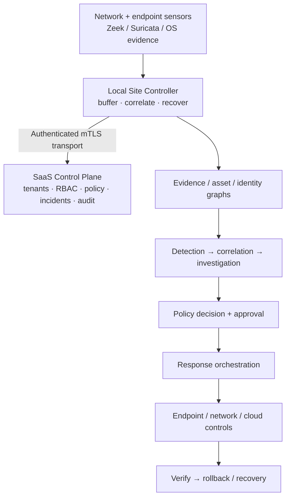

# MON Security Fabric

**Distributed, evidence-first network detection, investigation, safe containment and recovery.**

MON connects network and endpoint telemetry to asset identity, incident evidence, attack-path reconstruction and policy-gated enforcement. A local Site Controller continues collecting and recovering state when the SaaS control plane is unavailable. The intended lifecycle is:

```text
DISCOVER → DETECT → CORRELATE → TRACE → CONTAIN → VERIFY → RECOVER
```

[Architecture](docs/ARCHITECTURE.md) · [Current repository status](docs/repository-maintenance/README.md) · [Development](#development) · [Security](SECURITY.md) · [Engineering charter](PROJECT_INSTRUCTIONS.md)

> [!IMPORTANT]
> **This repository is under active engineering development; it is not a production-certified release.** The default `main` branch currently represents the integrated foundation through **8 October 2026**. Later three-PC and experimental lab implementations live on separate, unmerged branches. **Do not assume `main` equals the code currently running on a lab machine.** Review [deployment and branch reconciliation](docs/repository-maintenance/README.md) before updating any deployed host.

## What MON is built to answer

| Investigation question | Responsible subsystem |
|---|---|
| What happened, where and when? | Sensors, event normalization, evidence store |
| Which asset, user or service? | Asset/identity graph and correlation |
| What supports this finding? | Provenance-backed event and incident evidence |
| How did activity move? | Network topology and attack/investigation graph |
| Where can it be stopped safely? | Enforcement graph, capability registry and policy decision |
| Did containment work, and can it be reversed? | Response execution, verification, TTL and recovery |

MON does **not** assume that one edge firewall can see or stop everything. Inside/outside is context—not proof of trust. Volumetric upstream DDoS traffic cannot be fixed by a local firewall after the uplink is saturated.

## Architecture



The product target includes broader vendor-neutral connectors, packet references and scalable telemetry search. Not all target integrations are implemented or production-certified. For the actual code-level coverage and limitations on `main`, see the [implementation snapshot](docs/implementation-status-main-2026-10-08.md), [architecture baseline](docs/ARCHITECTURE.md) and [readiness evidence ledger](docs/production-readiness.md).

## Repository map

| Location | Purpose |
|---|---|
| [`src/mon/`](src/mon/) | Python APIs, event fabric, Site Controller, detection, graph and response engines |
| [`console/`](console/) | React/TypeScript SOC operator console |
| [`migrations/`](migrations/) | Versioned PostgreSQL schema changes; **must not be pruned** |
| [`tests/`](tests/) | Python security, API, integration and regression tests |
| [`e2e/`](e2e/) | Browser end-to-end acceptance tests |
| [`docs/adr/`](docs/adr/) | Accepted architecture decisions; preserve historical rationale |
| [`packaging/`](packaging/) | Linux/Windows packaging definitions |
| [`.github/workflows/`](.github/workflows/) | CI, release, resource, OS-native and rollback validation |
| [`demo/mon_cinematic/`](demo/mon_cinematic/) | **Synthetic presentation only**, not real detection or containment |
| [`docs/repository-maintenance/`](docs/repository-maintenance/) | Branch inventory, safe retirement and deployment reconciliation |

## Development

Requirements: Python 3.12+, Node.js 22 for the console, and Docker for optional disposable development environments.

```bash
git clone https://github.com/Saitanveesh/1.git
cd 1
python -m venv .venv
source .venv/bin/activate
python -m pip install -e '.[dev]'
ruff check .
pytest -q
```

To build and test the console:

```bash
cd console
npm install --no-audit --no-fund
npm test
npm run build
```

**Development-only container setup:** `docker compose up --build`. The included Compose file has known development credentials and publishes a control-plane port. It is **not a secure, supported production deployment recipe**; do not expose it on a shared network or use it with real sensitive telemetry. Production-like operation requires tenant isolation, secret management, authentication, mTLS and documented backup/restore gates.

Some tests require PostgreSQL, Linux network namespaces or dedicated Windows CI runners and will skip or fail when their external prerequisites are absent. Consult [CI workflows](.github/workflows/) and [production-readiness evidence](docs/production-readiness.md) for the actual validation boundaries.

## Response safety

Containment is not a one-click permanent block. MON's response design requires scoped evidence, confidence, a policy decision, an appropriate enforcement point, an expiration/TTL, an estimated blast radius, an audit record, verification and an executable rollback path. Critical assets require stricter policy and approvals. Network/host enforcement must first be validated in a disposable environment.

**No live telemetry or attack results are fabricated.** The cinematic demo is explicitly synthetic and must remain isolated from operational state.

## Branch and deployment policy

`main` is the **stable integration baseline**, not a place to force-merge an unreviewed lab release. As of 6 November 2026, 107 branches were inventoried and 13 open PRs contained unmerged work. The `release/mon-batch4-rc1` branch has a substantial independent implementation history, **461 commits ahead of the audited `main`**. It is retained for reconciliation rather than silently promoted or deleted.

A dated recovery manifest and an ancestry-gated branch-retirement process are in [repository maintenance](docs/repository-maintenance/README.md). See the [contribution guidelines](CONTRIBUTING.md) before starting more branches.

## Security, licensing and readiness

- Read [SECURITY.md](SECURITY.md) before disclosing a vulnerability or publishing any host credentials.
- [Project engineering rules](PROJECT_INSTRUCTIONS.md) describe tenant isolation, enforcement safety and release gates.
- [Production readiness ledger](docs/production-readiness.md) distinguishes evidence proven in disposable CI from what remains unproven in production.
- **No root open-source license is currently included.** Public access alone does not grant redistribution rights; licensing is a separate ownership decision.

**MON's objective is verifiable detection-to-recovery for critical networks—not demo-generated green status or a single-firewall dashboard.**
