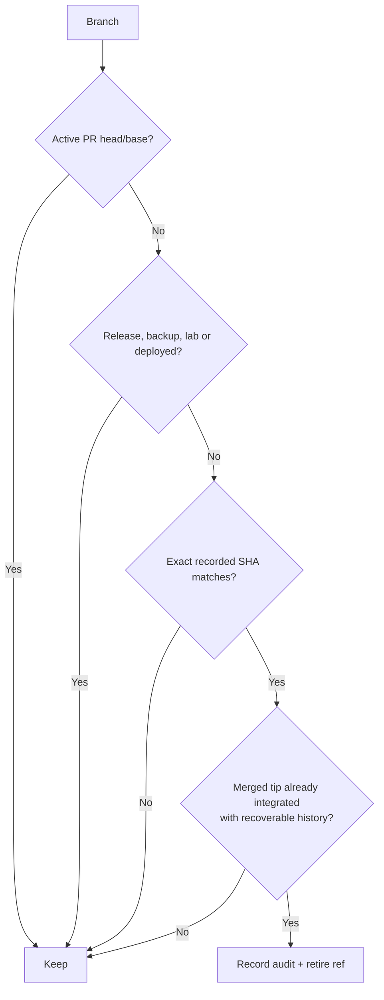
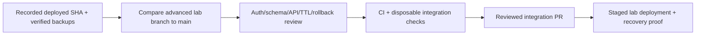

# GAUNT branch cleanup and deployment source of truth

The old MON repo has **two different histories**: stable `main` (integrated foundation) and newer, **unmerged** lab/release branches. The [historical 107-branch snapshot](repository-maintenance/branch-inventory-2026-11-06.json) predates [PR #100](https://github.com/Saitanveesh/1/pull/100), which successfully retired **20 verified integrated branches**. The latest inventory before this change showed **89 refs and 13 open PRs**; these counts are audit snapshots, not live deployment status.

## Preserve until reconciled

- `release/mon-batch4-rc1`: advanced lab work **not merged to main**.
- [Open PRs #79, #87 and #89–#99](https://github.com/Saitanveesh/1/pulls): preserve dependent features, migration and lab status until reviewed.
- `backup/*`, `lab/*` and branches with distinct commits/deployed use: preserve.
- `migrations/`, `docs/adr/`, CI and release tests: they are meaningful source, **not clutter**.

## Branch retirement

Once this PR is integrated, **only explicitly verified, non-deployment branding/maintenance branches** may be retired by a SHA-gated GitHub Actions job. Historic branch names, commit messages and PRs retain the names that existed at their creation; mass-rewriting every branch to say GAUNT would risk changing unmerged functionality.

## Lab cutover decision

No currently running PC or site service is modified by documentation-only rebranding. See [the previous branch cleanup report](repository-maintenance/README.md).
