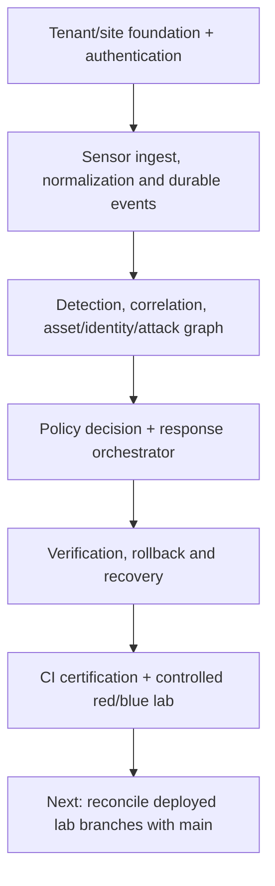

# GAUNT — project milestone and evidence

**Engineering maintainer:** Sai Tanveesh · **Implementation:** MON Security Fabric · **Presentation name:** GAUNT

## Engineering progression

## What the milestone demonstrates

| Area | What can be reviewed | Critical boundary |
|---|---|---|
| Distributed system | Site Controller, SaaS APIs, mTLS paths | Cloud failure still requires real local health monitoring |
| Multi-tenancy | PostgreSQL RLS and tenant/site test gates | No bypass-role deployment permitted |
| Network and endpoint evidence | Zeek/Suricata and Windows/Linux collectors | Coverage depends on actual source availability |
| Detection/incident graphs | Detection, correlation, identity and attack-path code/tests | Not all detections imply confirmed compromise |
| Containment and recovery | Policy, adapter, audit, TTL, reconciliation and tests | Most hardware integrations not production certified |
| SOC operator experience | React console and browser acceptance | No fake telemetry or synthetic operational scores |
| Red/blue lab | Historic runbooks, lab release branch, training target | Running version, scope and results require live verification |
| Release quality | CI, SBOM/provenance and disposable OS tests | Candidate builds are not commercial certifications |

## Evidence labels for faculty, interviews and demonstrations

**Implemented** = source code and test in a pinned commit; **CI-validated** = actual passing runner/job; **lab-observed** = operator-captured results on a specified host; **synthetic** = narrated demo or exercise model; **planned** = ADR, branch or design without validated integration.

The milestone is an end-to-end engineering architecture, security controls, operator integration and laboratory exercise track. It is not an assertion that all intended detection classes, hardware connectors or a production SaaS release are finished.

## Next release gate

Record the deployed SHAs from all hosts → verify backups → compare the large lab branch delta → review auth/schema/API/policy compatibility → exercise isolated response and rollback → integrate with a reviewed PR → staged cutover.

[Readiness ledger](production-readiness.md) · [Lab track](RED_BLUE_RANGE.md) · [Technical flows](WORKFLOWS.md).
