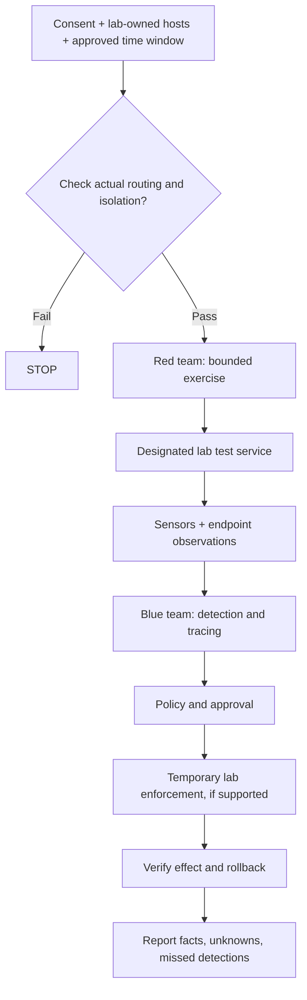

# GAUNT — authorized red/blue range

GAUNT is a **critical-network defense and controlled red/blue lab milestone**, not a packaged attack simulator or a hypervisor that automatically isolates networks. The main branch has tested defensive foundations and a *synthetic* narrated demo; later [lab release code](https://github.com/Saitanveesh/1/tree/release/mon-batch4-rc1) includes additional PC5 training-target, monitoring and operator functionality which is **not merged to main**.

## Provenance map

| Source | Supports | Does not prove |
|---|---|---|
| `main` application and tests | Implemented MON detector, sensor, incident, response foundations | General safe operation on arbitrary live networks |
| `demo/mon_cinematic/` | Presentation-only narrated incident | Actual attack or containment |
| [Lab release branch](https://github.com/Saitanveesh/1/tree/release/mon-batch4-rc1/lab/pc5-training-site) | Advanced lab target source and tests | Current deployed code or outcomes |
| [PR #93](https://github.com/Saitanveesh/1/pull/93) | Proposed multi-lab isolation work | Finished isolation |
| [PR #99](https://github.com/Saitanveesh/1/pull/99) | Planned three-PC migration | Completed Docker migration |
| [Historical lab runbook](lab-seven-system-test-day.md) | Multi-host laboratory procedure | Today's health of any physical PC |

## Two-role exercise

## Rules of engagement

1. Exercise only against explicitly authorized, dedicated lab assets. **A shared campus LAN is not a sandbox**; separate computers or an overlay VPN alone do not prove isolation.
2. Verify physical/logical segmentation, attacker/victim routing, management-path protection, host firewall scope and stop conditions from both sides **before generating traffic**.
3. Set and record time, source/target, packet/request budget, allowed protocols, CPU/memory budget, responsible operator and emergency shutdown.
4. Never conduct uncontrolled flooding, deploy real malware or disrupt a production/campus service.
5. Take PostgreSQL and Site Controller backups, verify restore in disposable infrastructure and document the before/after commit SHAs.
6. Capture actual evidence IDs, timestamps, signal source, confidence, finding, target, response TTL, outcome and service health. Do not fabricate attack outcomes.
7. Roll back controls; confirm service reachability and sensor health; report unresolved failure modes.

### Demonstration scenario (illustrative—not a claim of execution)

An authorized lab client produces repeated authentication failures against a dedicated test service. Blue-team observations are compared with endpoint authentication and network telemetry, then used for evidence-supported incident correlation. A temporary action is considered **only** if policy and a verified lab enforcement point permit it; verification and rollback complete the exercise. Results must come from actual observations.

### Acceptance evidence

- [ ] Authorization, scope and isolation verified
- [ ] Deployment SHA and lab topology recorded
- [ ] Sensor/collector clocks and health observed
- [ ] Evidence source + incident relationship documented
- [ ] Response policy, TTL and blast radius recorded
- [ ] Actual enforcement independently verified
- [ ] Rollback and service recovery independently verified
- [ ] Synthetic demonstrations clearly separated from live results

A full real-world critical-infrastructure deployment or vendor integration is **not proven** by completion of this lab checklist.
