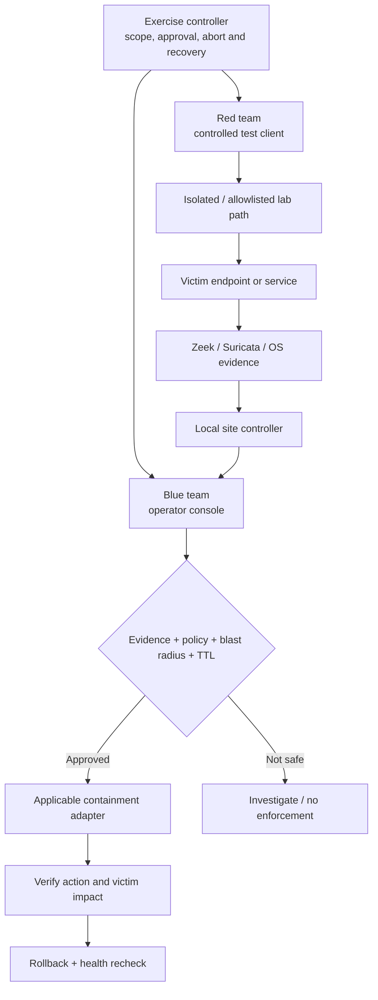

# Authorized red-team / blue-team sandbox

SERRATE is the **public demonstration identity** for the MON security fabric. The engineering milestone includes repository-based lab orchestration, isolated exercise planning, sensor ingestion, investigation and safe response paths. **This is a platform for authorized defensive validation, not a general-purpose exploit toolkit or unrestricted live attack service.**

## Roles and system boundaries

## What a lab demonstration can prove

1. **Discovery:** Identify actual lab assets and available collectors without inventing missing hosts.
2. **Detection:** Observe a bounded, approved synthetic or real test signal and retain its sensor/event provenance.
3. **Correlation:** Link permitted sources, assets, services and identities into an investigation.
4. **Trace:** Present evidence-backed relationships, not a guessed attack story.
5. **Contain:** Select an adapter available in the exercised environment; require policy approval for sensitive targets, bounded TTL and recorded blast radius.
6. **Verify:** Confirm action outcome and service/traffic state using an independent observation.
7. **Recover:** Revoke the action, check restoration and retain the audit trail.

## Safety prerequisites

- Written authorization and a concrete scope for every exercise. Do not run attack simulations on a campus LAN, an unsegmented shared network or production systems.
- Confirm network segmentation and external egress rules **before** test activity. “Private IP” alone does not mean isolated.
- Prepare out-of-band host access and tested recovery paths; do not first execute firewall changes on your main laptop.
- Keep actual JWTs, credentials, PC addresses and secrets out of the public repository and screenshots.
- Rate-limit test traffic, especially flood/DoS scenarios; do not generate disruptive traffic on shared networks.
- If a simulation is entirely synthetic, label it so viewers do not mistake it for live sensor detection.

## Evidence and status

The older seven-system Ubuntu runbooks and newer three-PC integration branches represent different phases of lab work. The source of truth for what is currently deployed is the **live host checkout SHA, service configuration and observed test results**, not an illustration or a branch name. See [lab command sheet](lab-seven-system-command-sheet.md), [test-day procedure](lab-seven-system-test-day.md), and [branch reconciliation](repository-maintenance/README.md).

Keep the cinematic example under `demo/mon_cinematic/` labeled synthetic. Claims about validated real telemetry require reproducible traces and measured observations from the specific environment.

## Milestone outcomes

The repository demonstrates the architecture and software engineering progression toward distributed security operations: tenant/site scoping, offline site behavior, sensor data flows, incident/evidence correlation, operator workflows, and policy-controlled reversible containment. Production appliance certification, general-purpose offensive attack execution, complete isolation of all live lab hosts and large-scale SaaS deployment are **not implied**.
