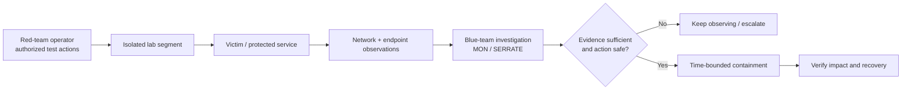
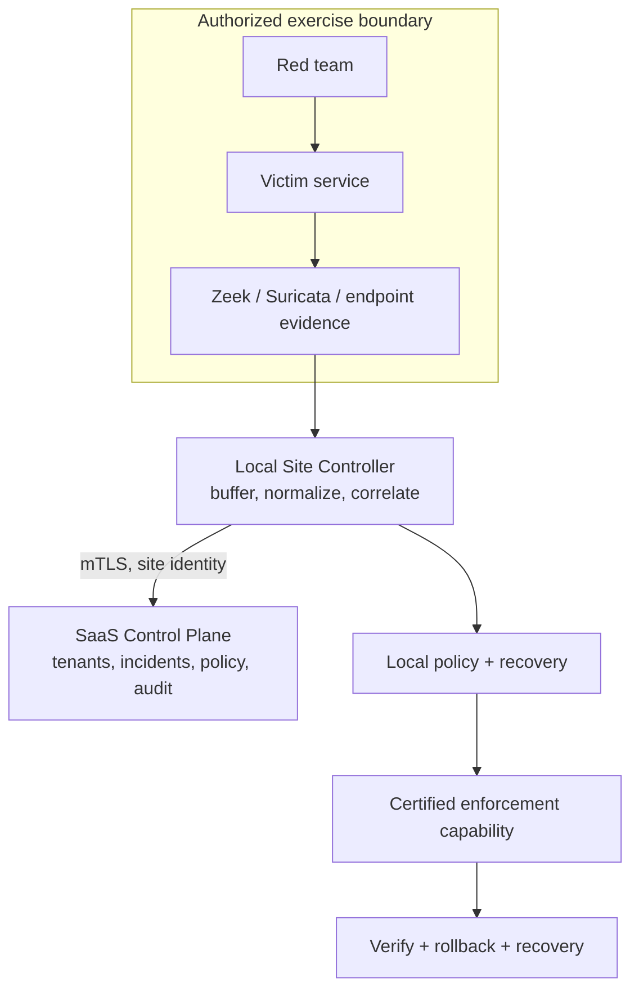
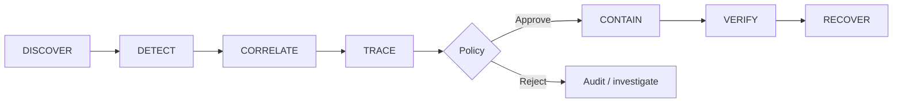
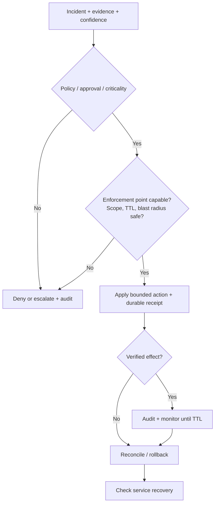

# SERRATE — architecture, lab flow and response gates

This page is deliberately **diagram-led**. These are explanatory flows built from repository architecture and lab runbooks, not a claim that every possible attack or connector is supported or independently certified.

## 1. What the sandbox demonstrates

**Control:** attacker tooling and test traffic are **not** the same as MON's detector. Test activity must only occur inside authorized segments, with verified isolation, consent, a stop condition and restoration procedure. Current lab history spans seven-host and three-host plans; do not claim any one topology is permanently active.

## 2. Where telemetry travels

Local protection cannot depend on uninterrupted cloud connectivity. A local firewall cannot mitigate upstream congestion after the upstream link is saturated.

## 3. Detection to verified recovery

Source evidence, identity scope, confidence, decision rationale, TTL, blast radius, audit and rollback are required for a defensible action.

## 4. Containment is a decision, not a button

## 5. Which claim is justified?

| Observable | What we can say | What we cannot infer |
|---|---|---|
| A Suricata IDS alert with raw evidence | Signature matched in a scoped event | Host definitely compromised |
| A failed authentication burst | Authentication-abuse indicator exists | Successful privilege escalation |
| A test incident from synthetic seeded data | Test pipeline functions in its declared environment | Real attacker was present |
| An adapter's successful disposable-namespace test | Adapter exercised in that test kernel/network namespace | All enterprise networks supported |
| A cloud/SaaS disconnect | Local delivery failure/offline state should be reported | Entire local sensor network is healthy |
| A rollback receipt + service check | Observed recovery for tested scope | Every production outage is prevented |

Supporting materials: [architecture](ARCHITECTURE.md), [readiness evidence](production-readiness.md), [lab walkthrough](lab-seven-system-test-day.md) and [repository reconciliation](repository-maintenance/README.md).
