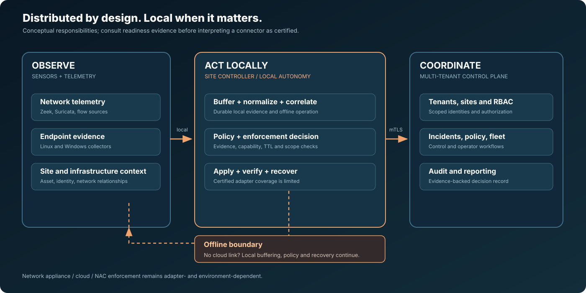
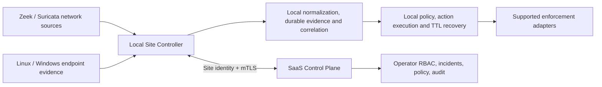
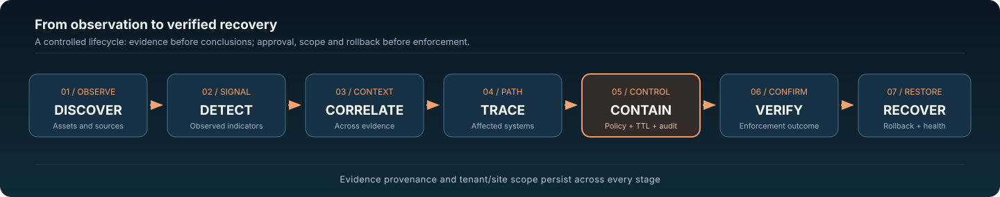
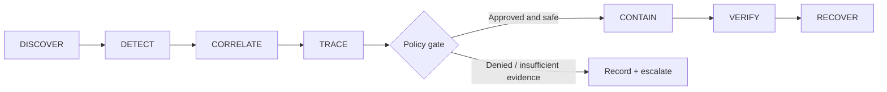
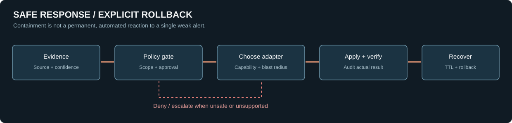
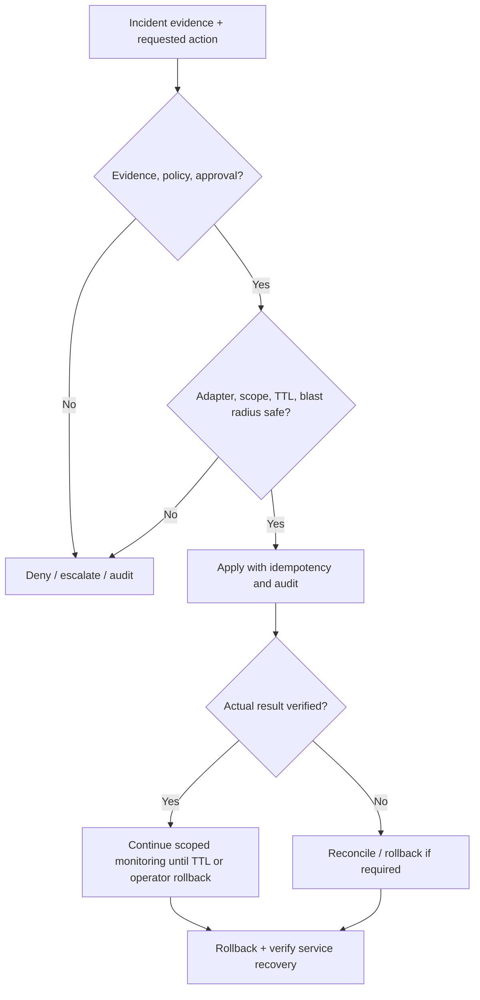

# System flows and response safety

These diagrams depict the **target architecture and current implemented foundations**, not guarantees of production certification. The authoritative capability status is in [the readiness ledger](production-readiness.md). The `main` baseline and newer lab branches are intentionally not conflated.

## 1. Distributed site-to-control-plane architecture

**Key boundary:** offline delivery cannot remove local event buffering, allowed local analysis, or recovery duties. Existing adapters are not a blanket claim that every firewall or NAC is certified.

## 2. Incident lifecycle

Each finding and incident must retain **source evidence**, tenant/site scope, observed facts versus inferences, confidence and timestamps. Tracing is a provenance-bound graph operation, not a fictional story about the attacker.

## 3. Controlled response and rollback

No permanent critical-asset isolation from a single weak detector. Every response object must have a defined rollback operation and explicit outcome. The right enforcement point can be endpoint, network, cloud or upstream only when a suitable adapter/integration is truly present and policy permits its use.

## 4. Failure-mode principles

| Condition | Intended safe behavior |
|---|---|
| SaaS unavailable | Local site buffering/analysis and permitted recovery continue; cloud state is marked unavailable |
| Sensor disconnected | Report missing data, sensor status and last-known evidence; do not fabricate normal traffic |
| Detector weak or ambiguous | Preserve observations and uncertainty; escalate instead of claiming compromise |
| Enforcement point unavailable | Fail closed or choose another policy-authorized verified point; never mark action as successful |
| TTL expires | Reconcile state, rollback and verify service condition; preserve audit record |
| Site identity or tenant mismatch | Reject cross-scope ingestion or command execution |
| Upstream volumetric DDoS saturates link | Local host firewall is insufficient; coordinate upstream mitigation where supported |

For code and acceptance evidence consult [the architecture baseline](ARCHITECTURE.md), [release gates](production-readiness.md) and [project engineering charter](../PROJECT_INSTRUCTIONS.md).
