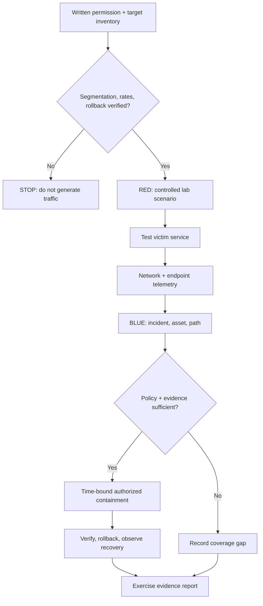
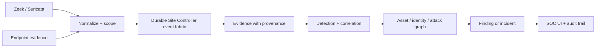
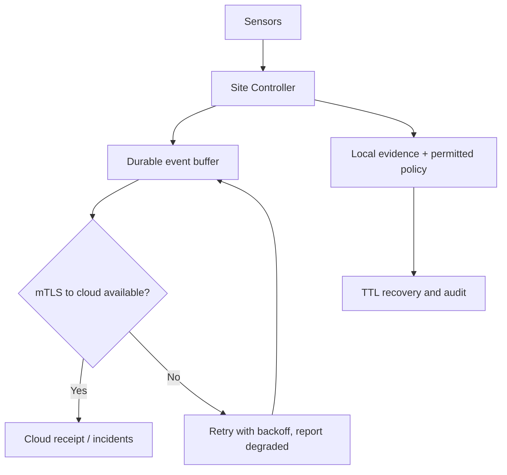
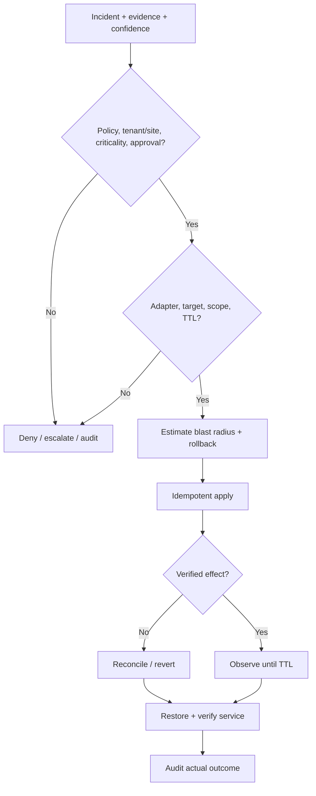
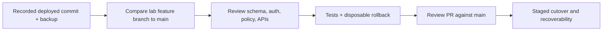

# GAUNT — technical flows

**Editable Mermaid diagrams, not AI artwork or telemetry screenshots.** These are engineering processes with coverage limitations: [readiness](production-readiness.md), [lab scope](RED_BLUE_RANGE.md).

## 1. Red/blue test boundary

## 2. Telemetry to incident

## 3. Cloud outage while a site continues

## 4. Containment must be rollback-ready

## 5. Safe lab-branch integration

**Failure contract:** no false sensor-health claims; weak signals remain uncertain; no unverified enforcement success; no attack exercise without explicit isolation; no permanent containment on a single detector. See [architecture](ARCHITECTURE.md).
