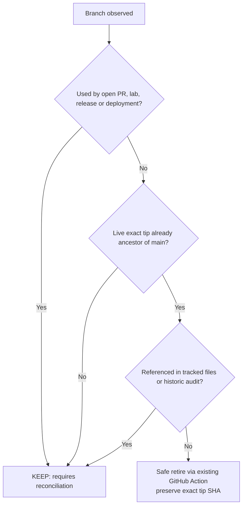

# Current branch review — 6 November 2026

This is a **snapshot**, not an instruction to purge history. The original cleanup removed 20 branch references proven to be fully integrated, and their tips are recorded in [the original retirement inventory](branch-inventory-2026-11-06.json).

| Branch class | Current observation | Action |
|---|---|---|
| `main` | Stable integration and public SERRATE presentation | Preserve |
| Open pull requests (15) | Active historical review records and potentially unique code | Preserve pending reconciliation |
| `release/`, `backup/`, `lab/`, `ops/` | Deployment, recovery or experiment references | Preserve unless the actual deployed release is verified |
| Merged PR branch with non-ancestor tip | Can contain unique commits despite merged PR label | Preserve |
| Fully merged, unchanged, unreferenced ancestor | Eligible only after live revalidation using existing retirement workflow | Retire safely |

**Branch refs observed in this snapshot:** 91 including `main`; source snapshot [JSON](branch-inventory-post-brand-2026-11-06.json).

## Operational rule

Do not mass rename old branches to SERRATE and do not force-push a new README across historic branch tips. Branches point to **code and deployment contracts**, not just presentations. Rewriting them risks corrupting open PRs, confusing lab machines and losing evidence.

The repository's [branch retirement policy](BRANCH_POLICY.md) and [earlier audit](README.md) remain authoritative. Do not claim that surviving branches are trash or that an unknown deployed checkout matches `main`.
