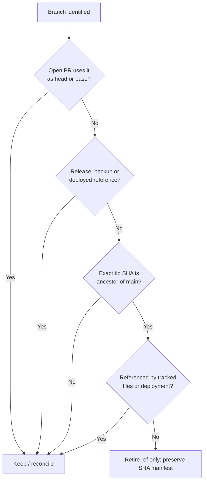

# Branch and deployment reconciliation — SERRATE/MON

The original MON repo has multiple development lineages. Branch names and dates alone do **not** identify the deployed version. The **main** branch is the stable integration line; it must not be force-replaced by an experimental lab build.

## Preservation rules

No rewriting archived PR branches, no deletion of divergent commits, no pruning database migrations, no relabeling old branch history to `SERRATE`, and no altering checked-out code on deployed lab hosts without a staged migration.

## Relevant present-day work

- `release/mon-batch4-rc1`: distinct implementation line and not yet reconciled with `main`.
- Open PRs for the 3-PC lab, isolation, SSH ingest and operator console can contain unique code and must not be deleted because they have old version suffixes.
- Earlier cleanup removed **20 fully-integrated branch references** via the proof-gated workflow; their recorded SHAs remain in `docs/repository-maintenance/branch-inventory-2026-11-06.json`.
- The source tree on `main` includes essential ADRs, migration chain, tests and release gates. These are not garbage.
- The historical `MON` name in old branch tips is valid audit history, not an error to rewrite.

## Safe operational next step

On each deployed machine, record checkout SHA, service process version, config fingerprints, schema revision and a verified restore point. Map them against a candidate integration PR. Run the existing GitHub acceptance gates, sandbox containment rollback and operator evidence verification before merging release-line changes.

**Do not claim every branch was cleaned or every component redeployed** merely because the public README was rebranded.
